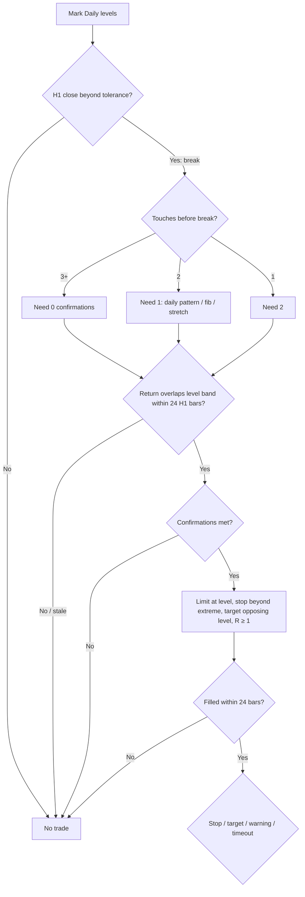

# Strategy — Breakout-then-Return (Retest)

> The only setup in scope. Exhaustive spec for implementation. Philosophy/why lives in `philosophy.md`. All numbers marked `(tunable)` live in `config.yaml`, never in code.

## 0. One sentence
Trade the first return to a freshly broken level: break, then come straight back — buy broken resistance, sell broken support — graded by pre-break touches with daily confirmations for young levels.

## 1. Scope
- **In:** H1 break/return triggers off Daily levels. Longs and shorts, mirror logic. FX majors + metals/oil; same rules everywhere.
- **Out:** SFP fading, MACD divergence, gaps/correlations, scaling. None of that may gate or trigger a retest signal.
- **Timeframes:** Daily defines levels, targets, and confirmation context. H1 defines break, return, entry, stop.

## 2. Definitions (all outputs at bar `t` use data ≤ `t`; ATR thresholds at `t` use ATR through `t−1`)
- **Swing high/low `(tunable: swing_lookback N=5)`:** bar `t` is a swing high iff its high is strictly greater than the highs of the N bars on each side (mirror for lows). Swings smaller than `min_swing_magnitude_atr = 0.3 × ATR(14)` are noise.
- **Level:** swing prices within `cluster_ticks = 10 ticks` merge into one level at their mean. Known only from confirmation bar onward (forming bar + N).
- **Touch:** H1 bar whose extreme reaches the level within `touch_tolerance_atr = 0.1 × ATR`. The forming swing counts as touch #1; consecutive touching bars form one episode.
- **Break:** H1 bar closing beyond the level by more than the touch tolerance. Resistance broken up → long setup; support broken down → short setup.
- **Return:** first post-break bar overlapping the tolerance band around the level while closing on the broken side, within `max_break_return_bars = 24` H1 bars.
- **Confirmations** (daily, completed bars only): `d1_pattern` (pin bar with wick ≥ `pin_wick_body_ratio = 2.0`× body, engulfing, or daily swing failure), `fib` (level within `fib_proximity_atr = 0.2`× ATR of a 38.2/50/61.8 retracement of the deep `fib_lookback = 20`-day high/low), `atr_stretch` (level ≥ `atr_stretch_multiple = 1.0`× ATR(20) from SMA20).
- **ATR:** Wilder ATR(14) on the trigger timeframe (20-period variant for stretch), read through the prior bar.

## 3. Rules, step by step
1. **Mark levels** on Daily per §2.
2. **Count touches** from level availability to the first break bar (episodes before it + forming swing).
3. **Grade:** 3+ touches → 0 confirmations; 2 touches → 1; 1 touch → 2.
4. **Wait for the return** within 24 H1 bars of the break. Later returns are stale — no trade.
5. **Check confirmations** at the return bar; skip when short of the required count.
6. **Enter:** limit at the level (or at the nearest fib within proximity when `special_fib_rule`), valid `limit_expiry_bars = 24` H1 bars. Unfilled limits expire with no trade.
7. **Stop:** beyond the return-bar extreme + `stop_buffer_atr (0.1 × ATR)`. Skip when stop distance < `min_stop_atr (0.25 × ATR)` — stops inside noise.
8. **Target:** nearest opposing level; fallback `entry ± fta_fallback_atr (2.0 × ATR)`.
9. **Min-R filter:** skip when `(target − entry) < min_reward_risk (1.0) × risk`.
10. **Warning-sign exit:** first H1 close back through the return extreme exits immediately.

## 4. Flowchart

## 5. Parameters (all in `config.yaml`)
`levels:` touch_tolerance 0.3. `retest:` — max_break_return_bars 24, touch_gates 3:0/2:1/1:2, pin_wick_body_ratio 2.0, bias_sfp wick/close 0.1/0.05, fib_lookback 20, fib_ratios 38.2/50/61.8, fib_proximity 0.2, special_fib_rule on, atr_stretch 20×1.0, stop_buffer 0.25, fta_fallback 2.0, min_reward_risk 1.0, min_stop_atr 0.7, limit_expiry 24, max_level_age_days 365 (drop stale levels). `session:` — enabled, entry 0-20 UTC, flat 21:00, winners run / losers cut, Friday flat. Shared `backtest:` (per-pair pip sizes, exit slippage) as documented there.

## 6. Validation policy
Random-entry baseline must fail (engine honesty), walk-forward out-of-sample judges every tuning claim, significance (Sharpe CI + deflated Sharpe) before any edge claim. In-sample green alone adopts nothing.
